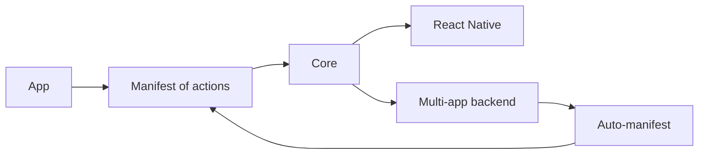

Public showcase of a private codebase in development since June 2026.

# Fiodos

Fiodos is an SDK for AI agents that run inside apps. The agent may only choose an action the app has already published, and a person stays in charge of what runs.

This repository is a public slice: the React Native package and the auto-manifest tool. The SDK core, the hosted backend, billing, and credentials stay private.

[Demo](https://fiodos.com/)

## 📊 The real codebase

The private repository has 634 commits, from 11 June 2026 to 29 October 2026.

Lines of tracked source, excluding dependency and build directories:

| Language | Lines |
|---|---:|
| Python | 172,730 |
| TypeScript | 111,704 |
| TSX | 91,169 |
| JavaScript | 44,949 |
| Swift | 4,221 |
| Kotlin | 3,332 |

```text
.
├── packages/
│   ├── core/
│   ├── react-native/
│   ├── react/
│   └── web-core/
├── tools/
│   └── auto-manifest/
├── backend/
├── dashboard/
├── examples/
├── native/
├── apps/
└── docs/
```




